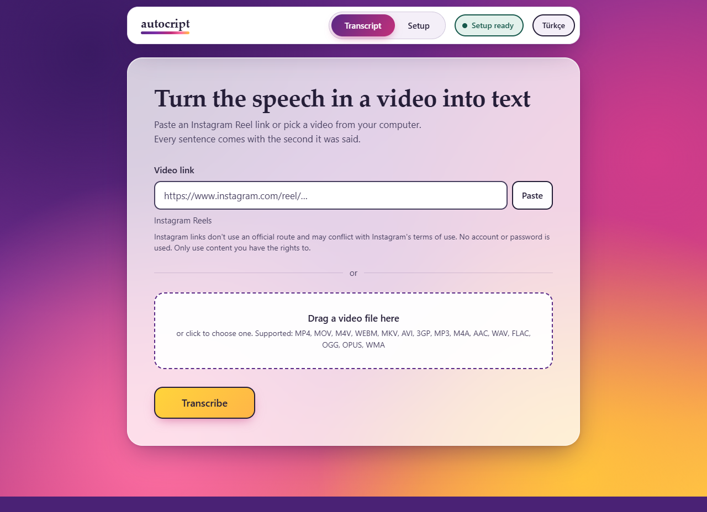

# autocript

A local Windows app that turns the speech in short videos into a sentence-by-sentence transcript with timestamps.

Türkçe kullanıcılar: kurulum ve kullanım rehberi [BENIOKU.txt](BENIOKU.txt) dosyasındadır.



## What it does

- Takes a YouTube Shorts link, an Instagram Reel link, or a video or audio file from your computer.
- Shows every sentence on its own line, starting with a `[mm:ss.ss]` timestamp.
- Exports TXT, SRT (subtitles), and JSON. The JSON format is described in [`schema/transcript-v1.json`](schema/transcript-v1.json).
- Marks words the speech-to-text engine was less sure about, when the engine reports confidence.
- Has a Turkish and an English interface.

It runs on your own computer with your own API keys; there is no server to set up. The audio is sent to ElevenLabs for transcription (or to Groq, if you add it as a backup).

## Download

1. Get `video-transkript-<version>-<commit>.zip` from the [latest release](https://github.com/MertOzyalcin/autocript/releases/latest).
2. Check that its SHA-256 matches the value in the release notes. In PowerShell:

   ```powershell
   Get-FileHash -Algorithm SHA256 .\video-transkript-*.zip
   ```

## Setup

You need:

- Windows 10 or Windows 11.
- An internet connection.
- About 400 MB of free disk space.
- An [ElevenLabs API key](https://elevenlabs.io/app/settings/api-keys) (**required**). See [ElevenLabs API pricing](https://elevenlabs.io/pricing/api).
- A [Groq API key](https://console.groq.com/keys) (**optional**, used as a backup when ElevenLabs is unavailable). See [Groq speech-to-text pricing](https://console.groq.com/docs/speech-to-text).

Then:

1. Right-click the zip file, choose **Properties**, tick **Unblock** if the box is there, and click **OK**.
2. Extract the zip to a simple folder such as `C:\video-transkript`. Do not run the app from inside the zip.
3. Double-click `baslat.cmd`. The first launch takes a few minutes: Python, packages, ffmpeg, and the download tools are fetched into the app folder. Keep the black window open while you use the app.
4. Your browser opens the Setup page in Turkish. Click **English** at the top right, paste your ElevenLabs key, click **Test**, then **Save**.

The full user guide is in [README.txt](README.txt).

## Limits

- Videos up to **3 minutes**.
- Sources: **YouTube Shorts**, **Instagram Reels**, or **file upload**. For Instagram, only a single video or Reel is supported.
- **Windows** only.
- YouTube or Instagram may block a download. The app tells you why and lets you upload the video file instead.
- Downloads from the same site are spaced at least 15 seconds apart.

## Known limitations

**Smart App Control** blocks unsigned tools (Python, ffmpeg and others), so the app does not run on a computer where it is on. `baslat.cmd` says so and closes when it is on, and warns and continues when it is in evaluation mode. If you wish, you can turn it off under Windows Security → App & browser control → Smart App Control; the choice is yours.

## Legal note

YouTube and Instagram links do not use an official method and may conflict with the sites' terms of use. No account or password is used. Use the app only for content you have the right to use.

## Credits

Link downloads are handled by [instapuller](https://github.com/MertOzyalcin/instapuller). Thanks to the instapuller project.

## License

[MIT](LICENSE)
